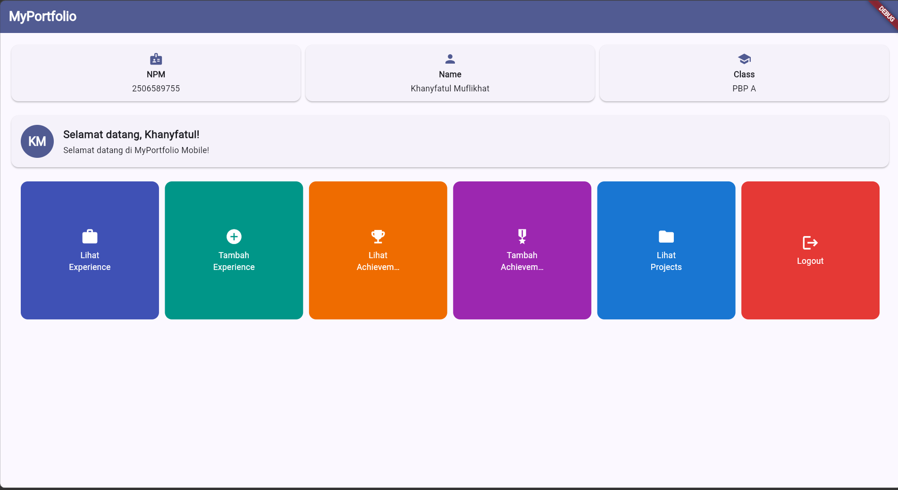
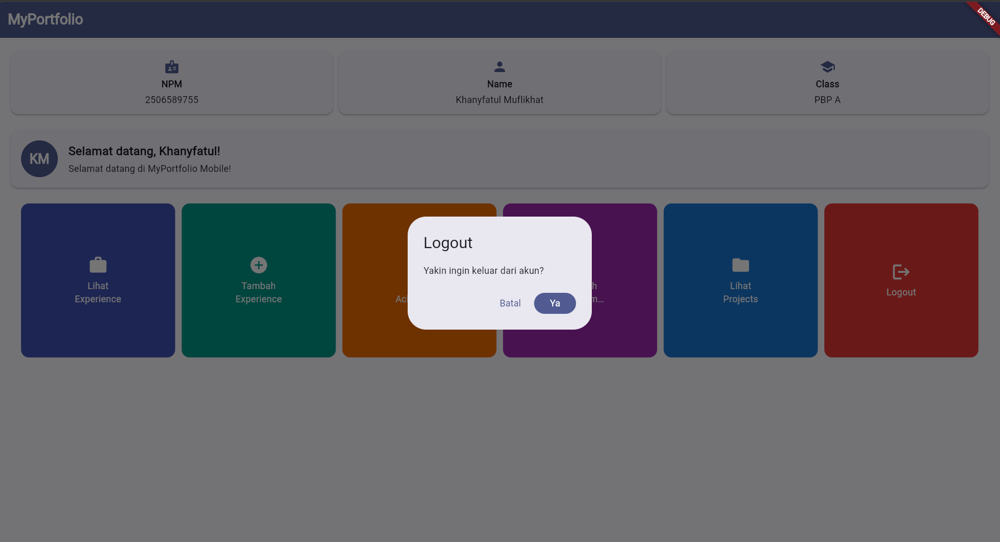
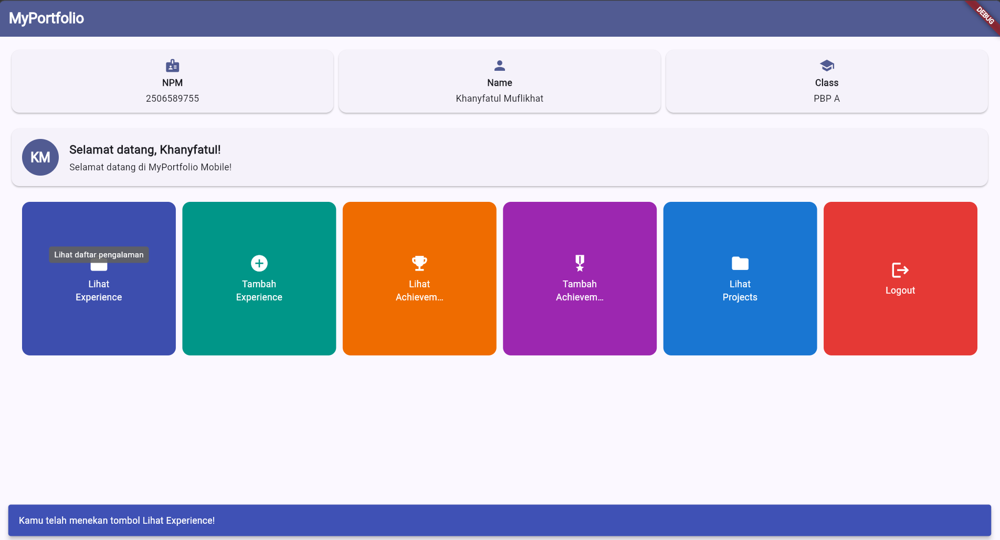
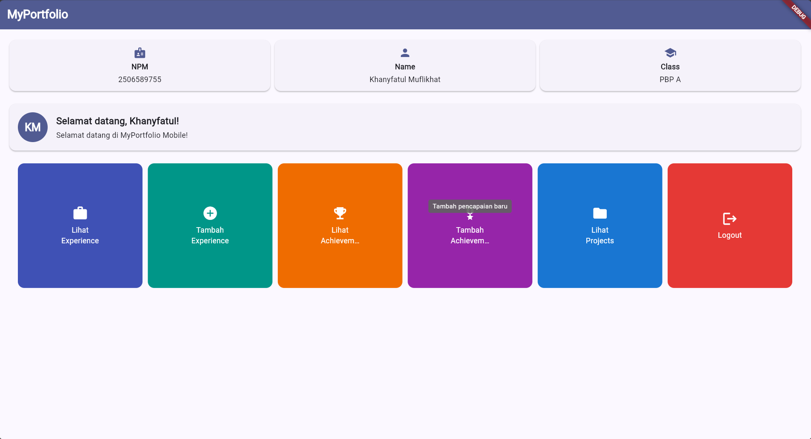

# MyPortfolio Mobile

[](https://flutter.dev)
[](https://dart.dev)


A Flutter mobile client for the personal portfolio of **Khanyfatul Muflikhat** (NPM 2506589755, class PBP A). It is the companion of the Django web portfolio [myportofolio](https://github.com/KhanyfatulMuflikhat/myportofolio) and will be connected to its REST API (`/api/v1/`) in a later tutorial.

Built for the *Pemrograman Berbasis Platform* (PBP) course, Tutorial 8 and Individual Assignment 7.

## Table of contents
- [Features](#features)
- [Screenshots](#screenshots)
- [Project structure](#project-structure)
- [Design decisions](#design-decisions)
- [Getting started](#getting-started)
- [Testing and code quality](#testing-and-code-quality)
- [Manual test checklist](#manual-test-checklist)
- [Known limitations](#known-limitations)
- [Weekly progress](#weekly-progress)
- [Reflective questions](#reflective-questions)
- [AI disclosure](#ai-disclosure)

## Features

**Required by the assignment**
- Home page `MyHomePage` as a `StatelessWidget` in `lib/menu.dart`, separate from the bootstrap file `main.dart`.
- Three `InfoCard`s showing my own NPM, name, and class.
- Six `ItemCard` action buttons (view/add Experience, view/add Achievement, view Projects, Logout). Each card has its own color, set through the `color` attribute of the `ItemHomepage` model, so there is no color branching logic.
- A `SnackBar` reading `Kamu telah menekan tombol [Button Name]!` when a card is tapped.
- `flutter analyze` reports no issues.

**Extra features**
- **Colored floating SnackBar:** it takes the color of the tapped card, so the user can see which button was pressed.
- **Logout confirmation dialog:** Logout asks "Yakin ingin keluar dari akun?" first. The SnackBar only appears after the user chooses "Ya".
- **Tooltips and semantics:** every card has a descriptive tooltip (from `ItemHomepage.description`) that appears above the card after a short 300 ms delay, so it does not cover the card label. Cards are also marked as buttons for screen readers.
- **Welcome header:** `WelcomeHeader` shows an avatar whose initials ("KM") and greeting name are derived from the full name, with no duplicated hardcoded data.
- **Icons on `InfoCard`.**
- **Responsive grid:** 3 columns on narrow screens, 6 columns from 900 px wide.
- **Overflow-safe cards:** card content scales down with `FittedBox` when a card gets too small, so no overflow stripes appear at any window width.
- **Scrollable page:** no overflow on short screens.

## Screenshots

| Wide screen (6 columns) | Narrow screen (3 columns) |
|---|---|
|  |  |

| Logout confirmation | Colored SnackBar | Tooltip |
|---|---|---|
|  |  |  |

## Project structure

```
lib/
├── main.dart                  # Entry point, MaterialApp and theme
├── menu.dart                  # MyHomePage: assembles the page
├── models/
│   └── item_homepage.dart     # Button data: name, icon, color, description, confirmMessage
└── widgets/
    ├── info_card.dart         # Identity card (icon, title, content)
    ├── item_card.dart         # Colored action card, tooltip, dialog, SnackBar
    └── welcome_header.dart    # Greeting card with initials avatar
test/
└── widget_test.dart           # Widget tests
docs/
└── screenshots/               # Images used in this README
```

## Design decisions

- **Separation of concerns.** `models/` holds data only, `widgets/` holds reusable components that know nothing about the page, and `menu.dart` only composes them.
- **Data-driven colors.** Color lives in `ItemHomepage`, and `ItemCard` just reads `item.color`. Adding a button is one entry in the `items` list.
- **Optional behavior through nullable fields.** `confirmMessage` and `description` are optional, so a button only gets a dialog or custom tooltip when it declares one. `ItemCard` has no special case for "Logout".
- **Stateless by design.** All data is fixed while the app runs, and dialogs and SnackBars are managed by Flutter, so no `StatefulWidget` is needed.
- **`context.mounted` check.** After awaiting the dialog, `ItemCard` checks `context.mounted` before showing the SnackBar.
- **Layout safety.** Grid cells are square, so card size follows the window width. `FittedBox(fit: BoxFit.scaleDown)` with `maxLines: 2` keeps the icon and label inside the card when cells get small, and leaves them at normal size otherwise.
- **Tooltip placement.** `preferBelow: false` puts the tooltip above the card so it does not cover the label, and `waitDuration` avoids flicker while the pointer moves across cards.
- **Documentation.** Every public class and field carries a `///` doc comment.

## Getting started

**Prerequisites**
- Flutter SDK (stable) with its bundled Dart SDK. Developed with <<paste the output of `flutter --version`>>.
- Edge or Chrome for running on the web. An Android emulator is not required.

**Run**
```bash
git clone https://github.com/KhanyfatulMuflikhat/myportofolio_mobile.git
cd myportofolio_mobile
flutter pub get
flutter run -d edge      # or: flutter run -d chrome
```

To preview a phone-sized layout without an emulator, resize the browser window to about 400 px wide.

## Testing and code quality

```bash
dart format .
flutter analyze    # expected: No issues found!
flutter test       # expected: All tests passed!
```

Widget tests in `test/widget_test.dart`:
1. The menu shows my identity, and tapping a card shows the matching SnackBar.
2. Logout shows a confirmation dialog first, and the SnackBar appears only after "Ya".
<<3. The welcome header shows the "KM" initials and the greeting (delete this line if the test is not added)>>

## Manual test checklist

| Check | Expected result |
|---|---|
| Open the app | Indigo AppBar "MyPortfolio", no red error screen |
| Top cards | NPM `2506589755`, Name `Khanyfatul Muflikhat`, Class `PBP A`, equal width |
| Welcome header | "KM" avatar and "Selamat datang, Khanyfatul!" |
| Width ≈ 400 px | 3 grid columns, no overflow stripes |
| Width ≥ 900 px | 6 grid columns |
| Drag the width slowly from 300 to 1200 px | No overflow stripes at any width, including around 900 px |
| Card colors | Six clearly different colors |
| Hover a card (real mouse) | Tooltip with the description appears above the card after a short delay |
| Tap "Lihat Experience" | Floating indigo SnackBar: `Kamu telah menekan tombol Lihat Experience!` |
| Tap other cards | SnackBar color changes, old SnackBar is replaced |
| Tap "Logout" | Dialog with Batal / Ya, no SnackBar yet |
| Tap "Batal" | Dialog closes, no SnackBar |
| Tap "Logout" then "Ya" | Red SnackBar: `Kamu telah menekan tombol Logout!` |
| Short window height | Page scrolls, no overflow |
| Browser console | No errors |

## Known limitations

- **Buttons are not wired to real features yet.** Cards only show a SnackBar, as the assignment specifies. Real navigation and data come with the API integration.
- **Logout is a placeholder.** It confirms and then shows the SnackBar, but there is no session to end yet.
- **Tooltips in device emulation.** In the browser's phone emulation mode, input arrives as touch events, so tooltips need a long press and hover can be inconsistent. With a real mouse and a narrowed window they work normally.
- **Very small cards shrink their content.** Below roughly 300 px of window width the card label is scaled down by `FittedBox` instead of overflowing, which can make it small.
- **Profile data is hardcoded** in `menu.dart`. It could move into a dedicated data or config file later.

## Weekly progress

| Week | Topic | Status |
|---|---|---|
| Tutorial 8 | Flutter basics: project structure, `menu.dart`, `InfoCard`, `ItemCard` | Done |
| Assignment 7 | Personal portfolio app: colored cards, SnackBar, modular refactor, extra features, overflow and tooltip fixes | Done |
| Next | Connect the app to the Django DRF API (`/api/v1/`) | Planned |

## Reflective questions

### Tugas 7

1. **Widget tree and parent-child relationships.** In Flutter almost everything is a widget, and widgets are nested into a tree. The root wraps other widgets, which wrap others, down to leaves such as `Text` and `Icon`. A widget that wraps another is its parent, and the wrapped one is its child. The relationship does two jobs. Layout flows through it: the parent passes size constraints down, the child picks its size within them, and the parent decides its position. Inherited data such as `Theme` or `ScaffoldMessenger` also flows down, so any descendant can read it through its `BuildContext`. In this project the tree is roughly `MaterialApp` → `MyHomePage` → `Scaffold` → `SingleChildScrollView` → `Column` → (`Row` of `InfoCard`s, `WelcomeHeader`, `GridView` of `ItemCard`s).

2. **Widgets used and their functions.**
   - `MaterialApp`: the app root; sets the title, theme, and home page.
   - `Scaffold`: the page skeleton (AppBar and body) and the place where SnackBars appear.
   - `AppBar`: the top title bar.
   - `SingleChildScrollView`: makes the page scrollable so it never overflows.
   - `Padding`: adds space around its child.
   - `Column` and `Row`: lay out children vertically and horizontally.
   - `Expanded`: makes a child fill the free space in a `Row`, so the three `InfoCard`s have equal width.
   - `SizedBox`: adds empty space or fixes a size.
   - `LayoutBuilder`: reads the available width, used to choose 3 or 6 columns.
   - `GridView.count`: shows the `ItemCard`s in a grid.
   - `Card`: a container with elevation and rounded corners (`InfoCard`, `WelcomeHeader`).
   - `Container` and `Center`: padding and alignment inside a card.
   - `FittedBox`: scales card content down when it does not fit, preventing overflow.
   - `Material` and `InkWell`: the colored background and the ripple effect on tap.
   - `Tooltip`: shows a description above the card on hover or long press.
   - `Semantics`: tells screen readers the card is a button.
   - `Text` and `Icon`: display text and icons.
   - `CircleAvatar`: the round avatar with initials.
   - `AlertDialog`, `TextButton`, `FilledButton`: the Logout confirmation dialog and its Batal/Ya buttons.
   - `SnackBar` (shown through `ScaffoldMessenger`): the short notification at the bottom.
   - Custom widgets: `MyHomePage`, `InfoCard`, `ItemCard`, `WelcomeHeader`.

3. **`MaterialApp`.** It bundles what a Material Design app needs: the theme (`ThemeData`), the home page, navigation (`Navigator` and routes), localization, and the `ScaffoldMessenger` that SnackBars rely on. Without it, widgets like `Scaffold`, `AppBar`, or `Theme.of(context)` have no context to work with. That is why it is usually the root: every widget below it inherits the same theme and services. Here, the indigo theme with an amber secondary color is set once in `MaterialApp`.

4. **`StatelessWidget` vs `StatefulWidget`.** A `StatelessWidget` keeps no changing state; its appearance depends only on the data it was built with. A `StatefulWidget` has a separate `State` object that holds changing data, and calling `setState()` rebuilds the widget. Use `StatelessWidget` when the UI does not change through interaction, as in this project (fixed identity, fixed menu, and dialogs/SnackBars managed by Flutter). Use `StatefulWidget` when data changes while the app runs, such as a counter, form input, a loading status, or data arriving from an API. A good rule is to start stateless and move to stateful only when something actually needs to change.

5. **`BuildContext`.** `BuildContext` marks a widget's position in the widget tree. With it, a widget can look upward to find ancestors, for example `Theme.of(context)` for theme colors, `ScaffoldMessenger.of(context)` to show a SnackBar, `Navigator.of(context)`, or `MediaQuery.of(context)` for the screen size. Flutter passes it into `build(BuildContext context)`, and we forward it to any helper that needs it. Because a context points to one specific position, it must come from the right place. In `ItemCard`, after awaiting the dialog we check `context.mounted` before showing the SnackBar, so we never use the context of a widget that has already left the tree.

6. **Hot reload vs hot restart.** Hot reload injects the updated code into the running Dart VM and rebuilds the widget tree, usually within a second, while keeping the app state. Hot restart reloads all the code and runs `main()` again, so the state is reset, but it is still faster than a full rebuild. Hot reload is not enough when we change `main()`, initial values of global or static variables, `initState`, or fundamentally change a class or enum. A full restart (stop, then `flutter run` again) is needed after changing dependencies in `pubspec.yaml`, adding plugins, changing assets, or changing native code such as `AndroidManifest.xml`.

## AI disclosure

**Tool:** Claude (Anthropic) through claude.ai.

**Prompting strategy.** I pasted the tutorial and assignment text manually since the AI cannot open the PBP site. I asked for changes as code snippets with their location instead of whole files, and asked for granular conventional commits. When something broke, I pasted the exact error output or file contents so the AI would not guess. I also gave it the grading rubric so suggestions aimed at extra features and code quality.

**AI-assisted parts**
- Splitting the code into `models/` and `widgets/`, with doc comments.
- Ideas and draft code for the extra features: Logout dialog, colored SnackBar, Tooltip/Semantics, `InfoCard` icons, responsive grid, `WelcomeHeader`.
- Draft widget tests and a draft of this README.
- Diagnosing errors from `flutter analyze`, `flutter test`, and the browser console output.

**Manual parts**
- Typing in and adjusting all the code and filling in my identity and tooltip descriptions.
- Running `dart format`, `flutter analyze`, `flutter test`, and testing in Edge (wide and narrow, resizing, hover, dialog, SnackBar).
- Fixing copy errors, taking screenshots, and doing all Git work.

**Critical reflection and AI limitations**
- The test instructions were confusing. I was told to "add a second test", but the default counter test was still in the file, so `flutter test` failed. I had to read the failure output to understand it and replace the whole file.
- Copy-pasting left real mistakes that the analyzer exposed: the `items` list in `menu.dart` still had the old tutorial version (missing arguments), a `;` and a `return` were missing in the `LayoutBuilder`, and a leftover `InkWell` block outside the `ItemCard` class produced 21 errors. The analyzer pointed to the places, and I read and cleaned the files myself.
- `flutter analyze` also caught an unused `material.dart` import in the test file. AI-written code is not automatically clean and must be verified with the tools.
- The AI-drafted `ItemCard` layout was not safe at small sizes. While resizing the browser window I saw `RenderFlex overflowed` errors in the console (cards of about 84 px could not fit a two-line label). Neither the analyzer nor the tests caught it, because they do not exercise small layouts. Only manual resizing found it. I applied `FittedBox` and `maxLines: 2` and re-checked by dragging the window across widths.
- When tooltips behaved inconsistently in phone emulation, I traced it to touch-input emulation rather than a code bug, and moved the tooltip above the card so it no longer covers the label. I documented the remaining emulation behavior under known limitations.
- I evaluated the AI's feature ideas instead of accepting all of them. The Logout confirmation, for example, delays the SnackBar, so I documented it as intentional behavior.

**Chat log:** [Log AI chat](https://claude.ai/share/af3724d2-c84b-424e-bb9b-411f4efa1cb3)

## Course context

Course project for PBP Gasal 2026/2027, Fasilkom UI.