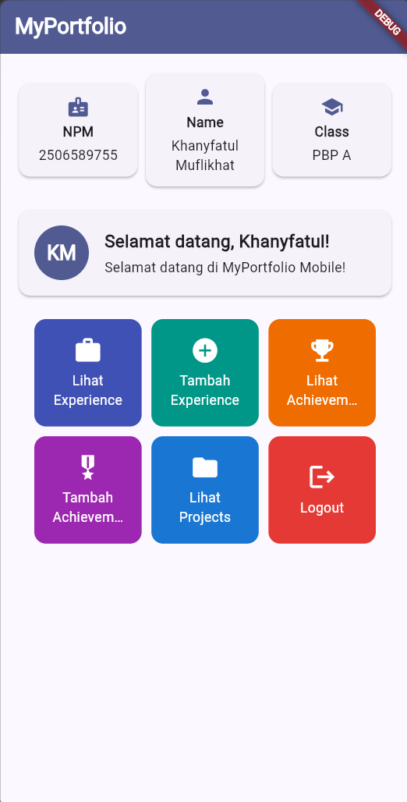

# MyPortfolio Mobile

[](https://flutter.dev)
[](https://dart.dev)


A Flutter mobile client for the personal portfolio of **Khanyfatul Muflikhat** (NPM 2506589755, class PBP A). It is the companion of the Django web portfolio [myportofolio](https://github.com/KhanyfatulMuflikhat/myportofolio) and will be connected to its REST API (`/api/v1/`) in a later tutorial.

Built for the *Pemrograman Berbasis Platform* (PBP) course: Tutorials 8 and 9, Individual Assignments 7 and 8.

## Table of contents
- [Features](#features)
- [Screenshots](#screenshots)
- [Project structure](#project-structure)
- [Design decisions](#design-decisions)
- [Form field mapping](#form-field-mapping)
- [Getting started](#getting-started)
- [Testing and code quality](#testing-and-code-quality)
- [Manual test checklist](#manual-test-checklist)
- [Known limitations](#known-limitations)
- [Weekly progress](#weekly-progress)
- [Reflective questions](#reflective-questions)
- [AI disclosure](#ai-disclosure)

## Features

**Home page (Assignment 7)**
- `MyHomePage` as a `StatelessWidget`, with three `InfoCard`s (NPM, name, class) and a welcome header.
- Seven colored `ItemCard` action buttons. Each color comes from the `color` attribute of the `ItemHomepage` model, so there is no color branching logic.
- `SnackBar` reading `Kamu telah menekan tombol [Button Name]!`, colored like the tapped card.
- Logout confirmation dialog, descriptive tooltips, `Semantics` for screen readers, a responsive grid (3 columns on narrow screens, 7 from 900 px wide), and `FittedBox` so cards never overflow.

**Navigation and forms (Tutorial 9 and Assignment 8)**
- **Drawer (`LeftDrawer`)** with Home, Add Project, Add Experience, and Add Achievement. The same drawer is used on every form page.
- **Add Project form (Tutorial 9)** with name, description, category, technologies, and link, plus a summary dialog.
- **Add Experience form (Assignment 8)**: title, description, category dropdown, start date picker, "still ongoing" switch, end date picker, and thumbnail URL.
- **Add Achievement form (extra)**: title, issuer, description, level dropdown, date picker (no future dates), and certificate URL.
- **Validation**: whitespace-only input is rejected, maximum lengths are enforced, URLs must be `http(s)`, and the end date cannot be before the start date. Errors appear on the related field as the user interacts.
- **Summary dialog** that appears only after all input is valid. Pressing OK closes it and resets the form.
- **Navigation from cards**: the "Tambah Proyek", "Tambah Experience", and "Tambah Achievement" cards open their forms with `Navigator.push()`. Each card declares its target page through a `destination` builder in `ItemHomepage`, so `ItemCard` has no checks on button names.
- **Narrow-screen friendly**: forms are scrollable, wrapped in `SafeArea`, and dismiss the keyboard on drag, so the Simpan button stays reachable.

## Screenshots

| Wide screen | Narrow screen |
|---|---|
|  |  |

| Logout confirmation | Colored SnackBar | Tooltip |
|---|---|---|
|  |  |  |

## Project structure

```
lib/
├── main.dart                      # Entry point, MaterialApp and theme
├── models/
│   └── item_homepage.dart         # Button data: name, icon, color, description, confirmMessage, destination
├── screens/
│   ├── menu.dart                  # MyHomePage: assembles the home page
│   ├── project_form.dart          # Add Project form (Tutorial 9)
│   ├── experience_form.dart       # Add Experience form (Assignment 8)
│   └── achievement_form.dart      # Add Achievement form (extra)
├── utils/
│   └── form_validators.dart       # Pure validation and date-format functions
└── widgets/
    ├── info_card.dart             # Identity card
    ├── item_card.dart             # Colored action card, tooltip, dialog, SnackBar, navigation
    ├── welcome_header.dart        # Greeting card with initials avatar
    ├── left_drawer.dart           # Navigation drawer
    ├── date_picker_field.dart     # Read-only field that opens showDatePicker
    ├── form_styles.dart           # Shared input decoration and field padding
    ├── form_page_scaffold.dart    # Shared form page skeleton
    └── summary_dialog.dart        # Shared summary dialog
test/
├── widget_test.dart               # Widget tests
└── form_validators_test.dart      # Unit tests for validators
docs/
└── screenshots/                   # Images used in this README
```

The tutorial calls the card widget `project_card.dart`. I kept it as `item_card.dart`, because it had already been split out in Assignment 7 and it serves every menu card, not only projects.

## Design decisions

- **Separation of concerns.** `models/` holds data, `utils/` holds pure logic, `widgets/` holds reusable components, and `screens/` composes them into pages.
- **Validation outside the UI.** `FormValidators` contains plain functions without state, so they are unit-tested without building any widget.
- **Data-driven colors and navigation.** `ItemHomepage` carries `color` and an optional `destination`. Adding a card that opens a page is one entry in the `items` list.
- **Reusable form building blocks.** `DatePickerField`, `formDecoration`, and `paddedField` are shared by all forms. <<`FormPageScaffold` and `showSummaryDialog` remove the duplicated page skeleton and summary dialog from the Experience and Achievement forms. (Delete this sentence if the refactor was not applied.)>>
- **Controllers are disposed.** Every `TextEditingController` is released in `dispose()`.
- **Date fields keep two pieces of state.** The `DateTime` is stored for validation, and a controller holds the text shown. The reset method clears both.
- **Drawer closes before navigating.** The drawer calls `pop()` and then `push()`, so going back from a form does not reveal an open drawer.
- **`context.mounted` check** after awaiting a dialog in `ItemCard`.
- **Layout safety.** `FittedBox(fit: BoxFit.scaleDown)` with `maxLines: 2` keeps card content inside small cards, and `preferBelow: false` places tooltips above cards.
- **Documentation.** Public classes and fields carry `///` doc comments.

## Form field mapping

Fields follow the models of the Django backend, so the later API integration needs no redesign. Categories, levels, and maximum lengths were matched with `main/models.py` <<(confirm this before submitting)>>.

| Form | Field | Django field | Input widget | Validation |
|---|---|---|---|---|
| Experience | Judul | `title` | `TextFormField` | required, max 100 |
| Experience | Deskripsi | `description` | `TextFormField` (5 lines) | required |
| Experience | Kategori | `category` | `DropdownButtonFormField` | fixed choices |
| Experience | Tanggal Mulai | `started_at` | `DatePickerField` | required |
| Experience | Masih berlangsung | `is_ongoing` | `SwitchListTile` | disables end date |
| Experience | Tanggal Selesai | `ended_at` | `DatePickerField` | required unless ongoing, not before start |
| Experience | URL Thumbnail | `thumbnail` | `TextFormField` (URL keyboard) | optional, `http(s)` |
| Achievement | Judul | `title` | `TextFormField` | required, max 100 |
| Achievement | Penyelenggara | `issuer` | `TextFormField` | required, max 100 |
| Achievement | Deskripsi | `description` | `TextFormField` (5 lines) | required |
| Achievement | Level | `level` | `DropdownButtonFormField` | fixed choices |
| Achievement | Tanggal Pencapaian | `date_achieved` | `DatePickerField` | required, not in the future |
| Achievement | URL Sertifikat | `certificate_url` | `TextFormField` (URL keyboard) | optional, `http(s)` |

## Getting started

**Prerequisites**
- Flutter SDK (stable) with its bundled Dart SDK. Developed with <<paste the output of `flutter --version`>>.
- Edge or Chrome for running on the web. An Android emulator is not required.

**Run**
```bash
git clone https://github.com/KhanyfatulMuflikhat/myportofolio_mobile.git
cd myportofolio_mobile
flutter pub get
flutter run -d edge      # or: flutter run -d chrome
```

To preview a phone-sized layout without an emulator, resize the browser window to about 400 px wide.

## Testing and code quality

```bash
dart format .
flutter analyze    # expected: No issues found!
flutter test       # expected: All tests passed!
```

- `test/form_validators_test.dart`: unit tests for required text (empty, whitespace, too long), optional URL, end date rules, past-or-today date, and date formatting.
- `test/widget_test.dart`: identity and SnackBar on the home page, Logout confirmation, the Project, Experience, and Achievement cards opening their forms, empty-form rejection, and the summary dialog after valid input.

## Manual test checklist

| Check | Expected result |
|---|---|
| Open the app | Indigo AppBar with a menu icon, no red error screen |
| Top cards | NPM `2506589755`, Name `Khanyfatul Muflikhat`, Class `PBP A` |
| Width ≈ 400 px / ≥ 900 px | 3 columns / 7 columns, no overflow stripes |
| Hover a card (real mouse) | Tooltip above the card after a short delay |
| Tap a plain card | Floating SnackBar in the card's color |
| Logout, then Batal / Ya | Dialog; no SnackBar on Batal; red SnackBar on Ya |
| Tap "Tambah Experience" | SnackBar, then the Experience form opens; Back returns to the menu |
| Drawer > Add Experience / Add Achievement / Add Project | Drawer closes, matching form opens |
| Drawer > Home from a form | The home page opens |
| Save an empty Experience form | Errors on title, description, start date, and end date |
| Title with only spaces | "Judul tidak boleh kosong!" |
| End date before start date | Date order error |
| Switch "Masih berlangsung" on | End date field disabled and cleared |
| Thumbnail `abc` / `https://x.com/a.png` | Error / accepted |
| Achievement date picker | Future dates cannot be selected |
| Fill a form completely, press Simpan | Dialog with all entries; OK closes it and clears the form |
| Width ≈ 400 px, short height | Form scrolls, Simpan reachable, no overflow |
| Browser console | No errors |

## Known limitations

- **Form data is not saved.** Forms only validate and show a summary dialog, as the assignment specifies. Sending data to the Django API comes later.
- **Logout is a placeholder.** It confirms and shows the SnackBar, but there is no session to end yet.
- **Home from the drawer stacks a new home page.** It uses `pushReplacement`, as in the tutorial. After opening a form from a card, the stack becomes menu, menu, and Back returns to the older menu. `pushAndRemoveUntil` would clear the stack.
- **Categories and levels are hardcoded** in the forms. They should come from the API later.
- **`project_form.dart` keeps the tutorial's layout.** It uses a hardcoded `Colors.indigo` and its own button style, so it is slightly less consistent than the other forms.
- **Tooltips in device emulation.** With touch emulation, tooltips need a long press. With a real mouse they work normally.
- **Profile data is hardcoded** in `menu.dart`.

## Weekly progress

| Week | Topic | Status |
|---|---|---|
| Tutorial 8 | Flutter basics: project structure, `menu.dart`, `InfoCard`, `ItemCard` | Done |
| Assignment 7 | Personal portfolio app: colored cards, SnackBar, modular refactor, extra features | Done |
| Tutorial 9 | Navigation, drawer, forms, input elements, refactor into `screens/` and `widgets/` | Done |
| Assignment 8 | Experience form (plus Achievement form), validation, date pickers, summary dialog, drawer and card navigation | Done |
| Next | Connect the app to the Django DRF API (`/api/v1/`) | Planned |

## Reflective questions

### Tugas 7

1. **Widget tree and parent-child relationships.** In Flutter almost everything is a widget, and widgets are nested into a tree. The root wraps other widgets, which wrap others, down to leaves such as `Text` and `Icon`. A widget that wraps another is its parent, and the wrapped one is its child. The relationship does two jobs. Layout flows through it: the parent passes size constraints down, the child picks its size within them, and the parent decides its position. Inherited data such as `Theme` or `ScaffoldMessenger` also flows down, so any descendant can read it through its `BuildContext`. In this project the tree is roughly `MaterialApp` → `MyHomePage` → `Scaffold` → `SingleChildScrollView` → `Column` → (`Row` of `InfoCard`s, `WelcomeHeader`, `GridView` of `ItemCard`s).

2. **Widgets used and their functions.**
   - `MaterialApp`: the app root; sets the title, theme, and home page.
   - `Scaffold`: the page skeleton (AppBar and body) and the place where SnackBars appear.
   - `AppBar`: the top title bar.
   - `SingleChildScrollView`: makes the page scrollable so it never overflows.
   - `Padding`: adds space around its child.
   - `Column` and `Row`: lay out children vertically and horizontally.
   - `Expanded`: makes a child fill the free space in a `Row`, so the three `InfoCard`s have equal width.
   - `SizedBox`: adds empty space or fixes a size.
   - `LayoutBuilder`: reads the available width, used to choose the number of columns.
   - `GridView.count`: shows the `ItemCard`s in a grid.
   - `Card`: a container with elevation and rounded corners (`InfoCard`, `WelcomeHeader`).
   - `Container` and `Center`: padding and alignment inside a card.
   - `FittedBox`: scales card content down when it does not fit, preventing overflow.
   - `Material` and `InkWell`: the colored background and the ripple effect on tap.
   - `Tooltip`: shows a description above the card on hover or long press.
   - `Semantics`: tells screen readers the card is a button.
   - `Text` and `Icon`: display text and icons.
   - `CircleAvatar`: the round avatar with initials.
   - `AlertDialog`, `TextButton`, `FilledButton`: the Logout confirmation dialog and its Batal/Ya buttons.
   - `SnackBar` (shown through `ScaffoldMessenger`): the short notification at the bottom.
   - Custom widgets: `MyHomePage`, `InfoCard`, `ItemCard`, `WelcomeHeader`.

3. **`MaterialApp`.** It bundles what a Material Design app needs: the theme (`ThemeData`), the home page, navigation (`Navigator` and routes), localization, and the `ScaffoldMessenger` that SnackBars rely on. Without it, widgets like `Scaffold`, `AppBar`, or `Theme.of(context)` have no context to work with. That is why it is usually the root: every widget below it inherits the same theme and services. Here, the indigo theme with an amber secondary color is set once in `MaterialApp`.

4. **`StatelessWidget` vs `StatefulWidget`.** A `StatelessWidget` keeps no changing state; its appearance depends only on the data it was built with. A `StatefulWidget` has a separate `State` object that holds changing data, and calling `setState()` rebuilds the widget. Use `StatelessWidget` when the UI does not change through interaction, as on the home page (fixed identity, fixed menu, and dialogs/SnackBars managed by Flutter). Use `StatefulWidget` when data changes while the app runs, such as a counter, form input, a loading status, or data arriving from an API. A good rule is to start stateless and move to stateful only when something actually needs to change.

5. **`BuildContext`.** `BuildContext` marks a widget's position in the widget tree. With it, a widget can look upward to find ancestors, for example `Theme.of(context)` for theme colors, `ScaffoldMessenger.of(context)` to show a SnackBar, `Navigator.of(context)`, or `MediaQuery.of(context)` for the screen size. Flutter passes it into `build(BuildContext context)`, and we forward it to any helper that needs it. Because a context points to one specific position, it must come from the right place. In `ItemCard`, after awaiting the dialog we check `context.mounted` before showing the SnackBar, so we never use the context of a widget that has already left the tree.

6. **Hot reload vs hot restart.** Hot reload injects the updated code into the running Dart VM and rebuilds the widget tree, usually within a second, while keeping the app state. Hot restart reloads all the code and runs `main()` again, so the state is reset, but it is still faster than a full rebuild. Hot reload is not enough when we change `main()`, initial values of global or static variables, `initState`, or fundamentally change a class or enum. A full restart (stop, then `flutter run` again) is needed after changing dependencies in `pubspec.yaml`, adding plugins, changing assets, or changing native code such as `AndroidManifest.xml`.

### Tugas 8

1. **`push`, `pushReplacement`, and `pop`.** Flutter's `Navigator` keeps pages as a stack. `Navigator.push()` puts a new page on top, so the previous page stays underneath and the user can come back with the Back button. `Navigator.pushReplacement()` swaps the page on top for a new one, so the replaced page is gone and cannot be returned to. `Navigator.pop()` removes the top page and reveals the one below. To open a form from an action card, I use `Navigator.push()`. `ItemCard` reads the card's `destination` builder and pushes it right after the SnackBar, so the Back button returns to the home page. The Home option in the drawer uses `pushReplacement()` to open `MyHomePage`. When a form is open, the drawer's Home replaces the form with the home page. It is not a perfect reset: if the form was opened from a card, the older home page is still in the stack, so Back from the new home page shows the older one. `pushAndRemoveUntil` would clear the stack, and I noted this under known limitations. For the drawer's form options, I call `pop()` first to close the drawer and then `push()` to open the form, so the drawer is not left open when the user comes back.

2. **`Scaffold`, `AppBar`, and `Drawer` for consistency.** `Scaffold` gives every page the same skeleton with named slots (`appBar`, `drawer`, `body`), so each page only fills them. The `AppBar` gives a consistent title bar and an automatic menu icon whenever a `drawer` exists, and the `LeftDrawer` is one shared widget, so the same navigation is available from the home page and from all form pages without repeating code. An example of the portfolio theme used on several pages is the indigo primary color. It is defined once in `MaterialApp` through `ColorScheme.fromSeed`, and the home page, the Experience form, and the Achievement form read it through `Theme.of(context).colorScheme.primary` for their `AppBar`. The drawer header uses the same color. If the theme changes, these pages change together. The one exception is `project_form.dart`, which keeps the tutorial's hardcoded `Colors.indigo`.

3. **Form layout, spacing, and scrolling.** A form is naturally a vertical list of fields, so each form is a `Column` with `crossAxisAlignment: CrossAxisAlignment.start`, which keeps labels and fields aligned to the left edge. Each field is wrapped by `Padding` (through the shared `paddedField` helper) so fields do not touch each other or the screen edge, and the Simpan button sits in a `SizedBox` with full width so it is easy to tap. When screen space is limited, such as a phone in portrait or with the keyboard open, the content is taller than the screen. `SingleChildScrollView` makes the whole form scrollable, so every field and the Simpan button stay reachable. Without it Flutter would show overflow stripes. `SafeArea` keeps the form out of system bars and notches, and `keyboardDismissBehavior: onDrag` lets the user close the keyboard by dragging. Because the spacing and scrolling are in shared helpers, all three forms behave the same.

4. **`GlobalKey<FormState>`, `validator`, and `validate()`.** Each form has a `GlobalKey<FormState>` attached to its `Form` widget. The key gives the code access to the `FormState` from outside the widget tree, for example from the Simpan button's handler, which is not inside any field. Each `TextFormField` has a `validator`, a function that receives the current text and returns an error message when the value is not acceptable, or `null` when it is fine. When Simpan is pressed, `_formKey.currentState!.validate()` runs every validator in the form, shows the returned messages under the matching fields, and returns `true` only if all of them returned `null`. The summary dialog is shown only in that case. An example of a rejected value is a title made only of spaces, such as `"   "`: it is not empty, but after `trim()` it has no content, so the form shows "Judul tidak boleh kosong!". Another is an end date earlier than the start date. Choosing an input type or keyboard alone is not enough, because it only helps the user and does not enforce anything. A URL keyboard still allows typing `abc`, pasting any text is possible, and a keyboard cannot know that the end date must not be before the start date, because that rule involves two fields. Validation is the only step that checks the values themselves, so it must run before the data is accepted.

## AI disclosure

**Tool (all assignments):** Claude (Anthropic) through claude.ai.

**Chat log:** [Log AI chat](https://claude.ai/share/af3724d2-c84b-424e-bb9b-411f4efa1cb3)

### Tugas 7

**Prompting strategy.** I pasted the tutorial and assignment text manually since the AI cannot open the PBP site. I asked for changes as code snippets with their location instead of whole files, and asked for granular conventional commits. When something broke, I pasted the exact error output or file contents so the AI would not guess. 

**AI-assisted parts**
- Splitting the code into `models/` and `widgets/`, with doc comments.
- Ideas and draft code for the extra features: Logout dialog, colored SnackBar, Tooltip/Semantics, `InfoCard` icons, responsive grid, `WelcomeHeader`.
- Draft widget tests, and diagnosing errors from `flutter analyze`, `flutter test`, and the browser console.
- A draft of the README and reflective answers.

**Manual parts**
- Typing in and adjusting all the code, and filling in my identity and tooltip texts.
- Running `dart format`, `flutter analyze`, `flutter test`, and testing in Edge (wide and narrow, resizing, hover, dialog, SnackBar).
- Fixing copy errors, taking screenshots, and all Git work.

**Critical reflection and AI limitations**
- The test instructions were confusing. I was told to "add a second test", but the default counter test was still in the file, so `flutter test` failed. I had to read the failure output to understand it.
- The AI-drafted `ItemCard` layout overflowed at small sizes. Neither the analyzer nor the tests caught it. Only dragging the browser window and reading the console found it, and I fixed it with `FittedBox` and `maxLines: 2`.
- When tooltips behaved inconsistently in phone emulation, I traced it to touch-input emulation rather than a code bug, and moved the tooltip above the card so it no longer covers the label.
- I evaluated the AI's feature ideas instead of accepting all of them. The Logout confirmation delays the SnackBar, so I documented it as intentional behavior.

### Tugas 8 (including Tutorial 9)

**Prompting strategy.** Same manual workflow as Tugas 7: I pasted the Tutorial 9 and Assignment 8 text, asked for step-by-step commit messages, and pasted exact errors when something failed. I also asked for design opinions, for example whether to add a second form or a shared-widget refactor and whether to polish the design or finish the documentation first given the deadline.

**AI-assisted parts**
- Adapting Tutorial 9 to my project: drawer, project form, and navigation through a `destination` builder in `ItemHomepage` instead of checking button names.
- Draft of the Experience form, `DatePickerField`, and `FormValidators`.
- Draft of the extra Achievement form and the shared form helpers (`formDecoration`, `paddedField`<<, `FormPageScaffold`, `showSummaryDialog`>>).
- Diagnosing the failing test output.
- Drafts of this README and the Individual Assignment 8 reflective answers, which I checked against my code.

**Manual parts**
- Typing in and adjusting all the code.
- Matching categories, levels, and maximum lengths with the Django `models.py` <<(confirm)>>.
- Running `dart format`, `flutter analyze`, and `flutter test`, and testing in Edge: opening forms from cards and the drawer, valid and invalid input, date pickers, narrow and short windows, and Home from the drawer.
- Moving files through VS Code so imports updated, taking screenshots, and all Git work.

**Critical reflection and AI limitations**
- The AI-written widget test for the Experience form failed on the first run. It tapped the date field after scrolling, so the tap missed and the date picker never opened, and the next step could not find its OK button. I read the failure output, understood it was a test problem and not an app bug, and fixed the test by waiting for the scroll to finish and by finding the picker's buttons by widget type instead of by text.
- The AI could not see my Django `models.py`. Its category and level choices and length limits were assumptions, so I compared them with the real model instead of trusting them.
- Reading my own answer about `pushReplacement`, I noticed that Home from a form opened via a card leaves an older home page in the stack. I documented it as a known limitation instead of hiding it.
- `project_form.dart` still follows the tutorial's layout (hardcoded color, its own button style). I left it unchanged on purpose to avoid altering the Tutorial 9 result, and documented the inconsistency.

## Course context

Course project for PBP Gasal 2026/2027, Fasilkom UI.